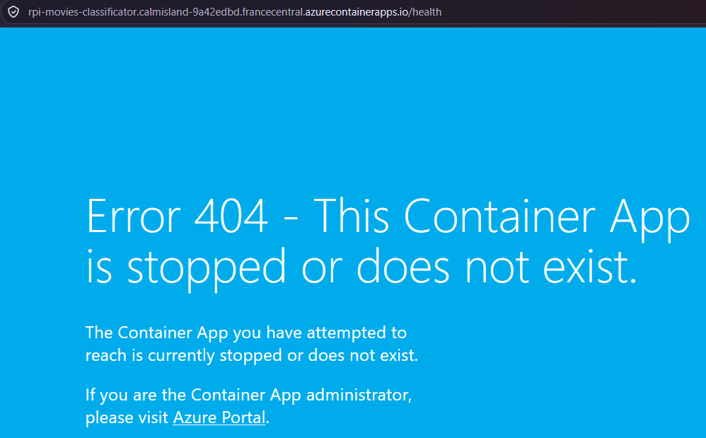
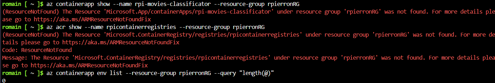
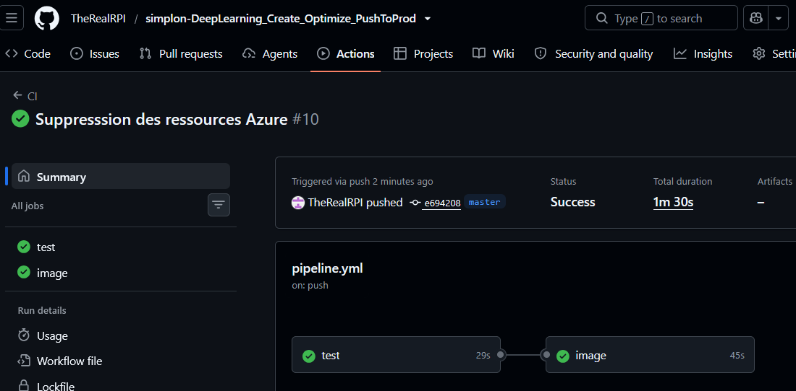

# FIN DE VIE — Suppression des ressources de production

> Relevé du coût, suppression de l'application, de son environnement et du
> registre Azure, puis preuves — conformément au brief (étape 15, « Le ménage »).
>
> Projet : DeepLearning_Create_Optimize_PushToProd | Auteur : TheRealRPI
> Rédaction : 27/10/2026 | Exécuté : **27/10/2026 après-midi** (PLAN.md, Phase 7, tâches 7.1 et 7.2 — en avance sur le planning)

---

## 1. Objet

La démonstration étant terminée (production en ligne, déploiement et rollback
validés le 27/10 — jalons J5 et J6), les ressources cloud n'ont plus d'usage.
Le brief impose de les supprimer, pour une raison économique : **un registre est
facturé tant qu'il existe, même si personne ne l'utilise** — de même pour la
Container App.

Ce document sert à la fois de **procédure** (sections 2 à 4, exécutées le 27/10
au cours de l'après-midi) et de **rapport** (sections 5 à 7, complétées au fil de l'exécution).

## 2. Composants à décommissionner (tâche 7.3 du PLAN.md)

Inventaire exact des ressources créées le 27/10/2026 (phases 5 et 6),
toutes dans le groupe de ressources `rpierronRG` :

| # | Composant | Nom / Valeur | Créé le | Supprimé le |
|---|-----------|-------------|---------|-------------|
| 1 | Azure Container App (1 vCPU, 2 Go RAM, ingress externe) | `rpi-movies-classificator` | 27/10 ~11h00 | **27/10 ~15h00** ✅ |
| 2 | Environnement Container Apps (managed environment) | `az containerapp env list` → `0` depuis la suppression (preuve P2) | 27/10 | **27/10 ~15h00** ✅ |
| 3 | Azure Container Registry (offre Basic, utilisateur admin activé) | `rpicontainerregistries` (`rpicontainerregistries.azurecr.io`) | 27/10 09h16 | **27/10 ~15h00** ✅ |
| 4 | Images Docker stockées dans l'ACR | `film-api:f1e8f24`, `:698c6c4`, `:35603b5`, `:cedacd2` | 27/10 | supprimées avec le registre |
| 5 | Secrets GitHub (environment `AzureContainerRegistries`) | `ACR_SERVER`, `ACR_USERNAME`, `ACR_PASSWORD` | 27/10 | **27/10 ~16h30** ✅ (environment supprimé) |

**Ce qui n'est PAS supprimé** (à conserver) :

- le **groupe de ressources `rpierronRG`** : partagé, le brief interdit
  formellement de le supprimer ;
- le **dépôt GitHub** (code, notebook, modèle, documentation) : gratuit, il
  reste la source de tout le travail ;
- les artefacts locaux (`model/`, données, notebook) : reproductibles depuis le dépôt.

> Rien d'irremplaçable n'est détruit : les images `film-api` se reconstruisent
> depuis le dépôt via la CI si le projet reprend un jour.

## 3. Procédure de suppression (tâches 7.1 et 7.2 du PLAN.md)

L'ordre est imposé par les dépendances : l'application vit dans l'environnement,
qui ne peut être supprimé qu'une fois vide ; le registre n'a plus d'usage une
fois l'application disparue. Les suppressions étant asynchrones, **laisser
~1 minute entre chaque étape**.

### Étape 1 — Relever le coût avant toute suppression (tâche 7.1)

Portail Azure → **Cost Management + Billing → Analyse des coûts**, portée sur le
groupe `rpierronRG`, période du 27/10 au jour J. Reporter le total dans la
section 5. (Le relevé se fait *avant* : une fois le groupe vidé, les données de
facturation restent disponibles mais sont moins directes à isoler.)

### Étape 2 — Supprimer la Container App (tâche 7.1)

```bash
az containerapp delete --name rpi-movies-classificator --resource-group rpierronRG --yes
```

L'adresse publique (`https://rpi-movies-classificator.calmisland-9a42edbd.francecentral.azurecontainerapps.io`)
cesse de répondre dès la suppression : c'est le comportement attendu — la preuve P1 le montre.

### Étape 3 — Supprimer l'environnement Container Apps (tâche 7.2)

```bash
# Relever son nom (un seul environnement attendu dans le groupe)
az containerapp env list --resource-group rpierronRG --query "[].name" -o tsv

# Le supprimer
az containerapp env delete --name <nom-environnement> --resource-group rpierronRG --yes
```

### Étape 4 — Supprimer le registre ACR (tâche 7.2)

```bash
az acr delete --name rpicontainerregistries --resource-group rpierronRG --yes
```

Les 4 images `film-api` listées en section 2 disparaissent avec le registre.

### Étape 5 — Vérifier et capturer les preuves (tâche 7.2)

Chaque commande doit désormais échouer avec une erreur **`ResourceNotFound`** —
c'est la preuve textuelle attendue par le brief (« une preuve (capture) que les
ressources n'existent plus ») :

```bash
az containerapp show --name rpi-movies-classificator --resource-group rpierronRG
az acr show --name rpicontainerregistries --resource-group rpierronRG
az containerapp env list --resource-group rpierronRG --query "length(@)"   # → 0
```

Capture d'écran du portail Azure : vue du groupe `rpierronRG` ne listant **plus
ni l'application, ni l'environnement, ni le registre**. À ranger dans `Gestion-de-projet/images/`
(voir section 6).

### Étape 6 — Nettoyer GitHub

Une fois l'ACR supprimé, le job `publier` de la pipeline ne peut plus réussir
(login ACR impossible), alors que la Phase 8 pousse encore des commits (README,
PLAN.md, journal). Pour garder une CI verte jusqu'à la livraison :

1. **Supprimer les secrets** : Settings → Environments → `AzureContainerRegistries`
   → supprimer les 3 secrets (ou l'environment entier). Sans objet : le registre
   n'existe plus.
2. **Supprimer le dossier local `Docs/`** : il contenait `azureContainer.txt`, le
   mot de passe administrateur du registre en clair (dossier jamais versionné —
   le mot de passe n'a jamais été poussé sur GitHub). Caduc une fois l'ACR
   supprimé, le dossier entier a été retiré le 27/10.
3. **Retirer le job `publier`** de `.github/workflows/pipeline.yml`, puis pousser :
   les jobs `test` et `image` doivent rester verts.
4. Consigner la fin de vie dans `Gestion-de-projet/JOURNAL_DES_VERSION.md`.

## 4. Vérification finale

| Vérification | Attendu | Statut |
|---|---|---|
| `GET /health` sur l'adresse publique | injoignable (DNS / 404) | ✅ 404 — preuve P1 |
| `az containerapp show` | erreur `ResourceNotFound` | ✅ preuve P2 |
| `az acr show` | erreur `ResourceNotFound` | ✅ preuve P2 |
| `az containerapp env list` | liste vide | ✅ `0` — preuve P2 |
| Groupe `rpierronRG` | toujours présent, vide des 3 ressources | ✅ résolu par la CLI, laissé en place (partagé) |
| Push GitHub après retrait du job `publier` | 2 jobs verts (`test`, `image`) | ✅ run #10 du 27/10 (`test` 29 s, `image` 45 s) — preuve P3 |

## 5. Coûts (estimés vs réels — tâche 7.1 du PLAN.md)

### 5.1 Tarifs réels relevés (27/10/2026)

| Ressource | Estimation (PLAN.md, § 2.4) | Tarif réel relevé | Facturation |
|---|---|---|---|
| ACR (offre Basic) | ~5 €/mois | **~4,40 €/mois** | à l'existence (facturé tant que le registre vit) |
| Container App (1 vCPU, 2 Go) | ~30-50 €/mois en charge continue | **~0,35 € / million de requêtes** | à l'usage (requêtes servies) |
| GitHub (dépôt + Actions, 10 runs) | 0 € (dépôt public) | 0 € | — |

### 5.2 Coût réel du projet

Les ressources ayant vécu moins d'une journée (suppression le 27/10 ~15h00 :
ACR ~6 h, API ~4 h), le coût réel se calcule au prorata :

| Ressource | Calcul | Coût réel |
|---|---|---|
| ACR | ~4,40 €/mois × 6 h / 730 h (au plus une journée de facturation : ~0,15 €) | **~0,04 €** |
| Container App | ~0,35 € / M requêtes × quelques dizaines de requêtes de test (`/health`, `/predict`, `/hello`) | **~0,00 €** (négligeable) |
| GitHub | — | 0 € |
| **Total** | | **~0,04 €** (au pire ~0,15 € si le registre est facturé à la journée) |

> **Écarts avec le PLAN.md** (à reprendre dans la fiche « plan vs réel », tâche 8.4) :
> l'estimation du registre était juste (~5 €/mois annoncés, 4,40 € réels), mais le
> modèle de facturation de la Container App était erroné — elle se facture **à
> l'usage** (~0,35 € / million de requêtes), et non en charge continue à 30-50
> €/mois. Avec quelques dizaines de requêtes de test, la part de l'API est
> négligeable : le coût total réel (~0,04 €, au pire ~0,15 € à la journée) reste
> très en dessous de la borne de ~5-10 € prévue au PLAN.md, qui couvrait un
> déploiement sur la semaine de brief.

## 6. Preuves de fin de vie (captures du 27/10/2026)

> Les trois preuves sont capturées et affichées ci-dessous — P3 : run #10 du
> 27/10 (commit `e694208`), 2 jobs verts après retrait du job `publier`.

**P1 — URL publique `/health` : erreur 404 après suppression**



**P2 — Vérifications CLI : `ResourceNotFound` sur l'application et le registre, plus aucun environnement**



**P3 — Run CI final : 2 jobs verts (`test`, `image`)**



## 7. Checklist de fin de vie (risque R9 du PLAN.md : « oubli de supprimer les ressources »)

- [x] Coût relevé (Cost Management, groupe `rpierronRG`) et reporté en section 5
- [x] Container App `rpi-movies-classificator` supprimée (27/10 ~15h00)
- [x] Environnement Container Apps supprimé (27/10 ~15h00)
- [x] Registre `rpicontainerregistries` supprimé (27/10 ~15h00)
- [x] Preuves capturées, enregistrées dans `Gestion-de-projet/images/` et affichées en section 6
- [x] Secrets GitHub `AzureContainerRegistries` supprimés (environment entier, 27/10 ~16h30)
- [x] Job `publier` retiré de la pipeline → CI verte (run #10 : 2 jobs)
- [x] Entrée de fin de vie ajoutée au `JOURNAL_DES_VERSION.md`
- [x] Colonnes « Supprimé le » et « Statut » de ce document complétées

---

*Document rédigé le 27/10/2026 par TheRealRPI — procédure exécutée le 27/10/2026 au cours de l'après-midi, en avance sur le planning (PLAN.md, Phase 7, tâches 7.1 à 7.3, jalon J7 « Ménage effectué »).*
