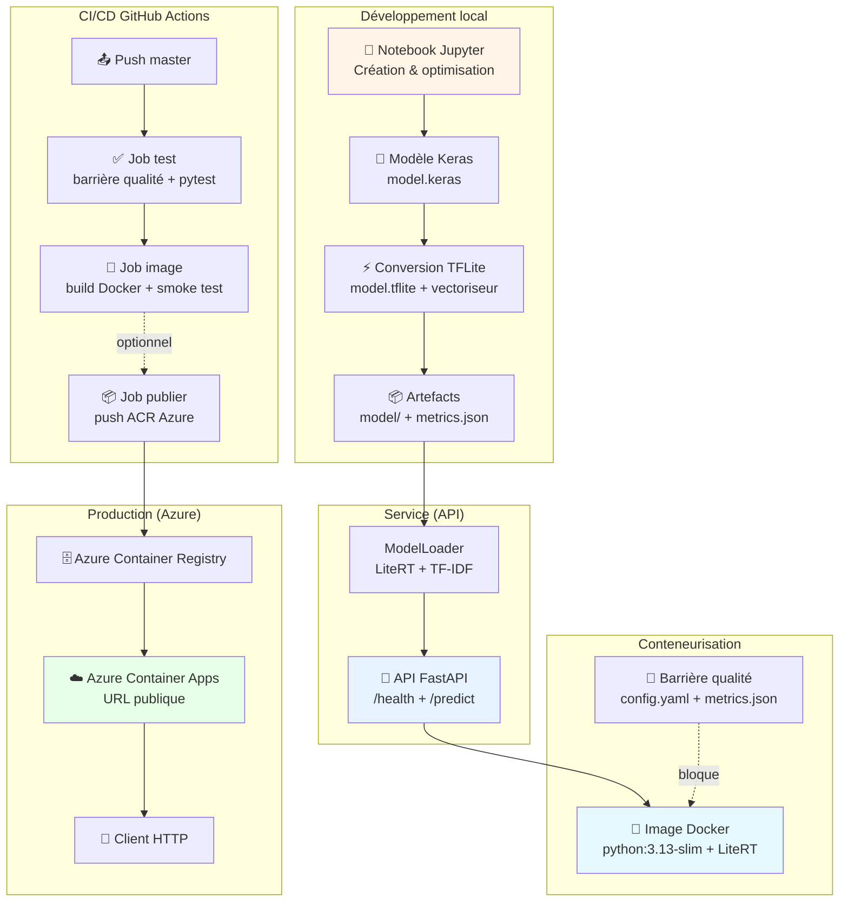
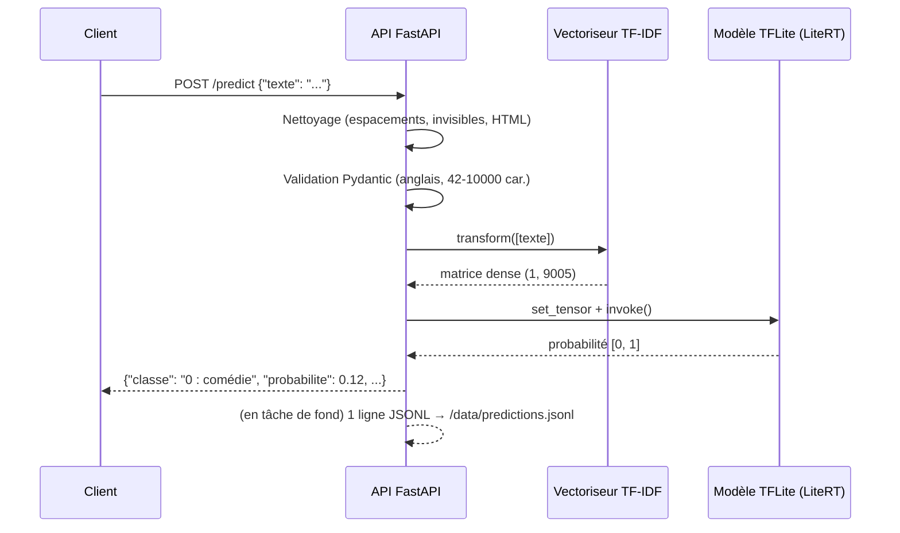
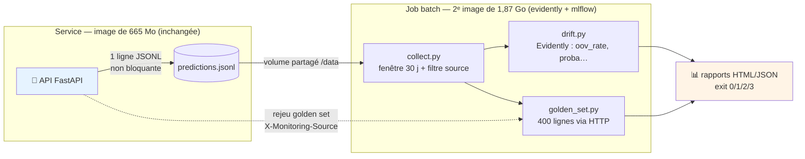
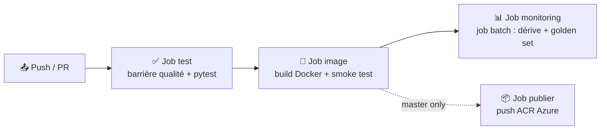

# 🎬 DeepLearning — Create, Optimize, Push to Prod

[](https://www.python.org/)
[](https://fastapi.tiangolo.com/)
[](https://www.tensorflow.org/)
[](https://www.docker.com/)
[](https://github.com/features/actions)
[]()

> **Classification de résumés de films (horreur vs comédie)** — Du notebook Jupyter au déploiement conteneurisé sur Azure.
>
> Projet académique réalisé dans le cadre de la formation Data Engineer — Simplon.co

---

## 📋 Table des matières

- [Description](#description)
- [Fonctionnalités](#fonctionnalités)
- [Architecture](#architecture)
- [Prérequis](#prérequis)
- [Démarrage rapide](#démarrage-rapide)
- [Utilisation](#utilisation)
- [Structure du projet](#structure-du-projet)
- [Scripts](#scripts)
- [Tests et qualité](#tests-et-qualité)
- [CI/CD](#cicd)
- [Auteurs](#auteurs)
- [Licence](#licence)

---

## Description

Ce projet illustre le cycle de vie complet d'un modèle de Deep Learning en production : de la création du modèle à partir d'un jeu de données de résumés de films, en passant par l'optimisation des hyperparamètres, jusqu'au déploiement d'une API REST conteneurisée.

Le modèle classifie un résumé de film (en anglais) en deux catégories : **comédie** ou **horreur**, avec un score F1 de **0,8571** sur le jeu de test.

---

## Fonctionnalités

- **Notebook complet** (8 parties) : audit des données, vectorisation TF-IDF, modèles de référence, optimisation KerasTuner/Optuna, évaluation, sauvegarde
- **Modèle optimisé** : réseau de neurones Keras avec recherche d'hyperparamètres (20 essais KerasTuner + 20 essais Optuna)
- **Conversion TFLite** : modèle quantifié (int8) — 12× plus léger (2,4 Mo vs 28,6 Mo) sans perte de performance
- **API FastAPI** : endpoints `/health` et `/predict` avec nettoyage du texte en entrée (espacements, caractères invisibles, HTML) et validation Pydantic (texte anglais, 42–10 000 caractères)
- **Barrière qualité** : vérification automatique des seuils (F1 ≥ 0,83, test_size ≥ 400) via `config.yaml`
- **Tests automatisés** : suite pytest complète (nettoyage + API + barrière qualité + monitoring, 91 tests)
- **Conteneurisation** : Dockerfile optimisé (image slim, sans TensorFlow, utilisateur non-root, healthcheck)
- **Monitoring du modèle** : dérive des entrées/prédiction (Evidently) + golden set rejoué via HTTP, dans une **deuxième image** dédiée (l'image de service ne gagne aucune dépendance) — cf. [`Gestion-de-projet/MONITORING.md`](Gestion-de-projet/MONITORING.md)
- **CI/CD GitHub Actions** : pipeline avec jobs `test` (barrière qualité + pytest), `image` (build Docker + smoke test) et `monitoring` (job batch + rapports archivés)
- **Documentation de gestion de projet** : PLAN.md, procédure de déploiement, journal des versions, fin de vie

---

## Architecture

**Comment les composants interagissent du notebook au déploiement :**



**Flux d'une prédiction en production :**



**Monitoring du modèle** — le service *constate*, un job batch *analyse* (détails : [`Gestion-de-projet/MONITORING.md`](Gestion-de-projet/MONITORING.md)) :



---

## Prérequis

| Outil | Version | Usage |
|-------|---------|-------|
| Python | ≥ 3.13 | Langage principal |
| [uv](https://docs.astral.sh/uv/) | dernière | Gestionnaire de paquets (recommandé) |
| Docker | dernière | Conteneurisation (optionnel pour le dev) |
| GPU CUDA | — | Entraînement du modèle (optionnel, le modèle est déjà fourni) |

> [!IMPORTANT]
> L'entraînement du modèle nécessite TensorFlow avec support GPU (`tensorflow[and-cuda]`).
> L'API de production n'utilise que **LiteRT** (léger, CPU uniquement) — pas besoin de GPU pour servir le modèle.

---

## Démarrage rapide

```bash
# 1. Cloner le dépôt
git clone https://github.com/TheRealRPI/simplon-DeepLearning_Create_Optimize_PushToProd.git
cd simplon-DeepLearning_Create_Optimize_PushToProd

# 2. Installer les dépendances (avec uv)
uv sync

# 3. Lancer l'API en local
uv run uvicorn deeplearning_create_optimize_pushtoprod.api:app --reload
```

L'API est accessible sur [http://localhost:8000](http://localhost:8000) — la documentation Swagger est sur [/docs](http://localhost:8000/docs).

**Avec Docker :**

```bash
# Construire et lancer le conteneur
docker build -t film-api .
docker run --rm -p 8000:8000 film-api
```

---

## Utilisation

### Endpoints disponibles

| Méthode | Route | Description |
|---------|-------|-------------|
| `GET` | `/` | Page d'accueil avec liens |
| `GET` | `/health` | Santé de l'API + infos modèle (version, F1, runtime) |
| `GET` | `/v1/models` | Liste des modèles (format standard ML) |
| `POST` | `/predict` | Prédiction horreur/comédie |

### Exemple de prédiction

**Requête :**

```bash
curl -X POST http://localhost:8000/predict \
  -H "Content-Type: application/json" \
  -d '{"texte": "A family moves into an old mansion deep in the countryside. Strange noises echo through the halls at night, and the walls seem to bleed when nobody is watching. One by one, the children vanish without a trace, and the mother discovers an ancient curse buried beneath the basement floor."}'
```

**Réponse :**

```json
{
  "classe": "1 : horreur",
  "probabilite": 0.9823,
  "version": "1.1.0",
  "type_modele": "tflite"
}
```

### Règles de validation

| Règle | Valeur |
|-------|--------|
| Nettoyage | Automatique (sauts de ligne, espaces multiples, caractères invisibles, HTML, URL, typographie → ASCII) |
| Langue | Anglais uniquement (détection automatique) |
| Longueur minimale | 42 caractères (comptés après nettoyage) |
| Longueur maximale | 10 000 caractères |
| Champ requis | `texte` (string) |

> [!WARNING]
> Un texte en français ou trop court renvoie une erreur **422** avec un message explicite.

---

## Structure du projet

```
DeepLearning_Create_Optimize_PushToProd/
├── .github/
│   └── workflows/
│       └── pipeline.yml              # CI/CD (jobs test + image + monitoring)
├── Data/
│   └── textes_films_horreur_comedie.csv  # Jeu de données (2 400 résumés)
├── Gestion-de-projet/
│   ├── PLAN.md                       # Planification du projet
│   ├── MONITORING.md                 # Documentation du monitoring du modèle
│   ├── PROCEDURE_MISE_EN_PRODUCTION.md  # Procédure de déploiement Azure
│   ├── JOURNAL_DES_VERSION.md        # Historique des déploiements
│   ├── FIN_DE_VIE.md                 # Suppression des ressources + coûts
│   └── images/                       # Captures de preuves
├── model/
│   ├── model.keras                   # Modèle Keras entraîné
│   ├── model.tflite                  # Modèle quantifié (int8) pour l'inférence
│   ├── vectoriseur.joblib            # Vectoriseur TF-IDF
│   ├── metrics.json                  # Métriques (F1, tailles, versions)
│   ├── reference.csv                 # Golden set (400 lignes rejouées au monitoring)
│   └── reference_drift.csv + .meta.json  # Référence de dérive (2 400 lignes, P0)
├── notebooks/
│   └── model_creation_optimisation.ipynb  # Notebook en 8 parties
├── scripts/
│   ├── check_golden_set.py           # Baseline F1 (à chaque réentraînement)
│   └── build_reference_drift.py      # Référence de dérive (à chaque réentraînement)
├── src/
│   └── deeplearning_create_optimize_pushtoprod/
│       ├── __init__.py
│       ├── api.py                    # API FastAPI (/health, /predict) + log monitoring
│       ├── model_loader.py           # Chargement TFLite + vectoriseur + inférence
│       ├── preprocessing.py          # Nettoyage du texte en entrée (/predict)
│       ├── quality_gate.py           # Barrière qualité (CLI)
│       ├── descriptors.py            # Descripteurs de dérive (oov_rate…) — stdlib
│       ├── predictions_log.py        # Log JSONL non bloquant — stdlib
│       └── monitoring/               # Job batch (image dédiée)
│           ├── collect.py            # Lecture JSONL + filtres + référence
│           ├── drift.py              # Rapports Evidently 0.7
│           ├── golden_set.py         # Rejeu HTTP + F1 servi
│           └── __main__.py            # CLI + codes de sortie 0/1/2/3
├── tests/
│   ├── conftest.py                   # Fixtures pytest
│   ├── test_api.py                   # Tests de l'API
│   ├── test_preprocessing.py         # Tests du nettoyage d'entrée
│   ├── test_quality_gate.py          # Tests de la barrière qualité
│   ├── test_descriptors.py           # Tests des descripteurs (oov_rate…)
│   └── test_predictions_log.py       # Tests du log JSONL (non-fatalité, concurrence)
├── config.yaml                       # Seuils qualité + section monitoring
├── docker-compose.yml                # Démo : api + monitoring + mlflow (profiles)
├── Dockerfile                        # Image API slim (LiteRT, pas TensorFlow)
├── Dockerfile.monitoring             # Image du job batch (+ son .dockerignore frère)
├── requirements-monitoring.txt       # Deps du job (versions épinglées)
├── pyproject.toml                    # Dépendances projet (uv + groupe monitoring)
├── requirements.txt                  # Dépendances runtime (image Docker API)
└── README.md
```

---

## Scripts

| Commande | Description |
|----------|-------------|
| `uv run uvicorn deeplearning_create_optimize_pushtoprod.api:app --reload` | Lancer l'API en mode développement |
| `uv run python -m deeplearning_create_optimize_pushtoprod.quality_gate` | Vérifier la barrière qualité |
| `uv run pytest -v` | Exécuter tous les tests |
| `uv run pytest tests/test_api.py -v` | Tests de l'API uniquement |
| `uv run pytest tests/test_quality_gate.py -v` | Tests de la barrière qualité uniquement |
| `uv run ruff check src/ tests/` | Linter le code |
| `docker build -t film-api .` | Construire l'image Docker |
| `docker run --rm -p 8000:8000 film-api` | Lancer le conteneur |
| `docker compose up -d api` | Démo monitoring : API + volume partagé |
| `docker compose run --rm monitoring` | Job de monitoring (rapports dans `data/monitoring/reports/`, exit 0/1/2/3) |
| `docker compose --profile ui up -d mlflow` | UI MLflow sur `:5000` — runs, métriques, artefacts, registry |
| `uv run python scripts/build_reference_drift.py` | Régénérer la référence de dérive (après réentraînement) |
| `uv run python scripts/check_golden_set.py` | Re-mesurer la baseline F1 du golden set (API requise) |

---

## Tests et qualité

### Tests automatisés

Le projet dispose d'une suite de tests complète (91 tests) :

- **Tests nettoyage** (`test_preprocessing.py`) : chaque règle de nettoyage (espacements, invisibles, typographie, HTML), idempotence, texte propre inchangé
- **Tests API** (`test_api.py`) : toutes les routes, validation Pydantic, cas d'erreur 422/500, non-régression du nettoyage (probabilité identique avec ou sans bruit)
- **Tests barrière qualité** (`test_quality_gate.py`) : modèle accepté, faux modèle refusé, robustesse (fichiers manquants/malformés)
- **Tests monitoring** (`test_descriptors.py`, `test_predictions_log.py`) : bornes d'`oov_rate`, schéma JSONL, motifs 422, header golden set, non-fatalité du log, désactivation, concurrence (20 threads)

```bash
uv run pytest -v
```

### Barrière qualité

Avant tout déploiement, le modèle doit passer une barrière qualité définie dans `config.yaml` :

| Seuil | Valeur | Justification |
|-------|--------|---------------|
| `f1_minimum` | 0,83 | F1_test − marge de bruit (0,8608 − 0,0313 = 0,8295) |
| `test_size_minimum` | 400 | Garantit un jeu de test statistiquement significatif |

```bash
# Vérifier le modèle (exit 0 = accepté, exit 1 = refusé)
uv run python -m deeplearning_create_optimize_pushtoprod.quality_gate
```

> Un modèle dégradé (F1 < 0,83) fait échouer le job CI `test` — l'image Docker n'est jamais construite.

---

## CI/CD

Le pipeline GitHub Actions (`.github/workflows/pipeline.yml`) s'exécute sur chaque push/PR :



| Job | Étapes | Durée estimée |
|-----|--------|---------------|
| `test` | install deps → barrière qualité → pytest | ~30 s |
| `image` | build Docker → smoke test `/health` + `/predict` | ~45 s |
| `monitoring` | rebuild 2 images (cache GHA) → API conteneurisée → job batch `--no-mlflow` → archivage des rapports | ~6 min |
| `publier` | login ACR → build + push image (tag = SHA) | ~1 min |

> [!NOTE]
> Le job `monitoring` sort en **2** (données production insuffisantes en CI) sans faire
> échouer le pipeline : c'est un warning neutre. Seuls les codes 1 (dérive ou régression
> du golden set) et 3 (API injoignable) mettent le pipeline au rouge. Le détail complet
> (table de décision, limites, calibrage) est dans
> [`Gestion-de-projet/MONITORING.md`](Gestion-de-projet/MONITORING.md).

> [!NOTE]
> Le job `publier` est commenté dans le workflow actuel (les ressources Azure ont été supprimées en fin de vie — voir `Gestion-de-projet/FIN_DE_VIE.md`). Il suffit de le décommenter et de configurer les secrets ACR pour réactiver le déploiement automatique.

---

## Auteurs

[TheRealRPI](https://github.com/TheRealRPI) — 🧙 Sorcier de la Data | Data Engineer en formation — [Simplon.co](https://www.simplon.co/)

---

## Licence

Projet académique — **Simplon.co**

Ce projet est réalisé dans le cadre du brief pédagogique « Deep Learning — Create, Optimize, Push to Prod ». Le code est librement réutilisable à des fins d'apprentissage.

---

*Dernière mise à jour : 28/10/2026*
